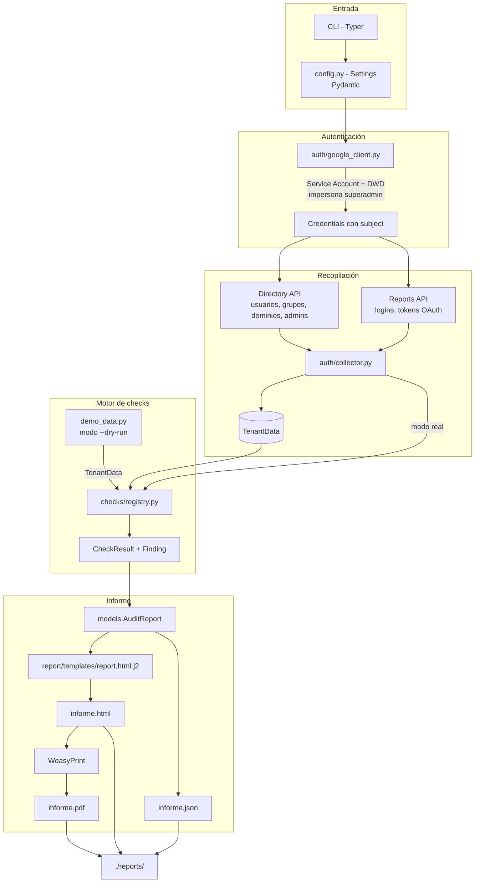

# Arquitectura

Este documento explica **cómo fluye la información** en `workspace-tenant-auditor`,
desde la autenticación hasta el informe final, y **por qué** cada capa está
separada como está.

## Visión general



## Flujo detallado

### 1. Autenticación (`auth/google_client.py`)

```
Service Account (JSON)  ──with_subject(superadmin)──▶  Credenciales con DWD
        │                                                       │
        └── scopes de solo lectura ─────────────────────────────┤
                                                                ▼
                                                   Cliente Admin SDK / Reports
```

- Se cargan las credenciales desde el JSON de la Service Account.
- `with_subject(delegated_admin_email)` aplica **Domain-Wide Delegation**:
  las llamadas se hacen "como" el superadmin configurado, respetando los
  permisos y quedando registradas en la auditoría del tenant.
- Los clientes se **cachean** por `(API, versión, subject)` para no reconstruirlos.
- Si falta configuración, se lanza `AuthError` con un mensaje accionable
  (fail-fast), antes de intentar ninguna llamada de red.

### 2. Recopilación (`auth/collector.py`)

- Cada endpoint se envuelve en un helper `_safe(...)`. Si una API falla
  (p. ej. falta un scope), **el error se registra en `TenantData.errors`** y la
  recopilación continúa. Resultado: una auditoría **parcial pero útil**.
- La paginación se centraliza en `_paginate()` (`nextPageToken`).
- Producción: `TenantData` (contrato neutral, serializable y testeable).

### 3. Motor de checks (`checks/`)

- Cada check es una **función pura** `run(TenantData, Settings) -> CheckResult`.
  - Sin red, sin estado global → **tests triviales**.
  - Añadir un check = implementar la función + registrarla en `registry.CHECKS`.
- El **registro** (`registry.py`) además:
  - Resuelve la selección `--checks id1,id2` con error claro si el id no existe.
  - Cronometra cada check y **aísla excepciones** en su propio `CheckResult`,
    de modo que un check roto no impide ver los demás.

**Filosofía anti-falsos-positivos:** si un dato no se pudo recopilar
(p. ej. `drive_policies = {}`), el check **no emite hallazgo**. Preferimos no
afirmar un riesgo que no podemos evidenciar antes que erosionar la confianza
del informe.

### 4. Agregación y generación de informe (`report/`)

- `AuditReport` agrega resultados, calcula:
  - `counts_by_severity()` → para el resumen ejecutivo.
  - `overall_score()` → puntuación de postura 0-100 (heurística transparente).
- **HTML** (Jinja2, `report.html.j2`):
  - Resumen ejecutivo con tarjetas y puntuación.
  - Gráfica de barras **en CSS puro** (compatible con PDF, sin JS) +
    **Chart.js** embebido opcional para el HTML interactivo.
  - Tabla de hallazgos por severidad y detalle con evidencia desplegable.
- **PDF**: WeasyPrint convierte el HTML. Si falla (faltan `pango`/`cairo`),
  se emite un aviso y se conservan HTML/JSON.
- **JSON**: `model_dump_json` para consumo programático (CI, dashboards).

## Estructura del repositorio

```
workspace-tenant-auditor/
├── src/tenant_auditor/
│   ├── __init__.py
│   ├── cli.py              # CLI (Typer)
│   ├── config.py           # Settings (Pydantic Settings)
│   ├── models.py           # Severity, Finding, CheckResult, TenantData, AuditReport
│   ├── demo_data.py        # datos para --dry-run
│   ├── auth/
│   │   ├── google_client.py  # Service Account + DWD
│   │   └── collector.py      # recopilación tolerante a fallos
│   ├── checks/
│   │   ├── registry.py       # registro + ejecutor
│   │   ├── two_step_verification.py
│   │   ├── weak_passwords.py # contraseñas + reenvío
│   │   ├── superadmins.py
│   │   ├── delegations.py
│   │   ├── drive_sharing.py
│   │   ├── external_groups.py
│   │   ├── oauth_apps.py
│   │   ├── secondary_domains.py
│   │   ├── retention_vault.py
│   │   ├── inactive_users.py
│   │   └── unassigned_ou.py
│   └── report/
│       ├── generator.py
│       └── templates/report.html.j2
├── tests/                 # pytest con mocks de la API
├── examples/demo_data/    # fixture JSON para el modo demo
├── docs/img/              # capturas del README
├── .github/workflows/ci.yml
├── Dockerfile
├── docker-compose.yml
├── pyproject.toml
├── .env.example
├── README.md / ARCHITECTURE.md / SECURITY.md / EXPLAINER.md
```

## Extensiones previstas

- **`checks/registry.py` es el único punto de acoplamiento**: un nuevo check no
  toca ni la CLI ni la capa de informes.
- **`TenantData` es el contrato**: para añadir datos nuevos, se amplía el modelo
  y se rellena en el collector; los checks ya existentes siguen funcionando.
