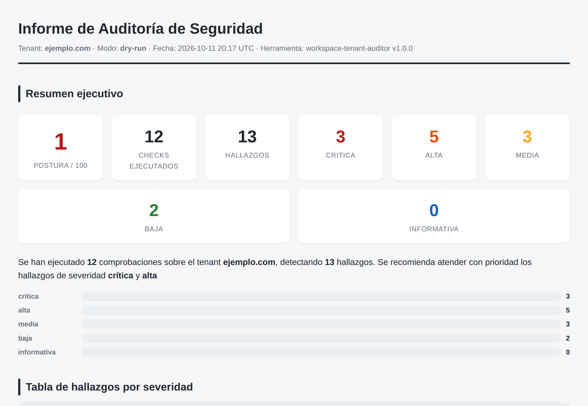
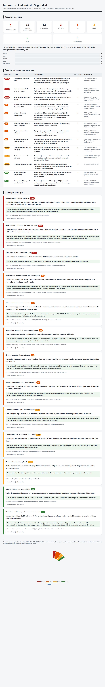
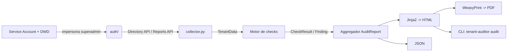

# workspace-tenant-auditor

> Auditor de seguridad y cumplimiento para tenants de **Google Workspace**.
> Ejecuta +12 comprobaciones sobre la configuración real del tenant, clasifica
> los hallazgos por severidad y genera un **informe ejecutivo (HTML/PDF/JSON)**
> con evidencia, recomendaciones y referencias a buenas prácticas.

[](https://github.com/arulcancela/workspace-tenant-auditor/actions)


---

> **¿No eres técnico o tienes poco tiempo?** Lee el
> **[EXPLAINER.md](EXPLAINER.md)**: explica el proyecto sin jerga, por qué
> importa a una empresa y las decisiones clave en lenguaje sencillo.
> La arquitectura técnica está en **[ARCHITECTURE.md](ARCHITECTURE.md)**.

## ¿Qué problema resuelve?

En organizaciones con Google Workspace, la postura de seguridad se degrada con
el tiempo: usuarios sin 2SV, superadmins de más, apps OAuth con permisos
excesivos, compartición pública en Drive, cuentas inactivas que nadie revisa...
Detectar todo esto a mano es lento, no es repetible y no queda documentado.

`workspace-tenant-auditor` convierte esa auditoría en **un comando**:

```
tenant-auditor audit --domain ejemplo.com --output ./reports
```

## ¿Para quién es?

- **Administradores de Google Workspace** que necesitan una foto de la postura
  de seguridad en minutos, no en días.
- **Consultores de migraciones enterprise** que entregan un informe de partida
  y de cierre a sus clientes.
- **Equipos de seguridad / compliance** que quieren evidencia auditable
  y repetible (ideal para alimentar un proceso de remediación).

## Captura del informe

**Resumen ejecutivo** — puntuación de postura (0-100) y conteo por severidad:



**Informe completo** — tabla de hallazgos por severidad, detalle con evidencia
desplegable y recomendaciones con referencia a la buena práctica:



> Estas capturas provienen de una ejecución en **modo demo** (`--dry-run`) sobre
> un tenant ficticio con problemas preparados a propósito. Cualquiera puede
> reproducirlas sin credenciales reales.

## Checks de auditoría (12)

| ID | Nombre | Severidad típica | Referencia |
|----|--------|------------------|------------|
| `2sv` | Usuarios sin verificación en dos pasos | crítica/alta | CIS §1.1 |
| `passwords` | Contraseñas sin cambiar en 180+ días | media | NIST 800-63B |
| `superadmins` | Superadmins: número y 2SV | crítica | CIS §1.2 |
| `delegations` | Delegación de dominio y acceso delegado | alta/media | CIS §1.3 |
| `drive` | Compartición externa en Drive | crítica | CIS §4.1 |
| `external_groups` | Grupos con miembros externos | alta/media | CIS §3 |
| `oauth` | Apps OAuth de terceros y scopes | crítica/alta | CIS §6 |
| `forwarding` | Reenvío automático de correo | alta/media | ATT&CK T1114.003 |
| `aliases` | Aliases y dominios secundarios | media | CIS §8 |
| `vault` | Política de retención y Vault | alta/media | CIS §9 |
| `inactive` | Cuentas inactivas (90+ días sin login) | alta/media | CIS §1.4 |
| `ou` | Usuarios sin OU o mal clasificados | media/baja | CIS §2 |

Cada hallazgo incluye: **id, nombre, severidad, descripción, evidencia cruda,
recomendación y referencia**.

---

## Instalación

### Con pipx (recomendado para uso como CLI)

```bash
pipx install git+https://github.com/arulcancela/workspace-tenant-auditor.git
```

### Con pip / entorno virtual

```bash
git clone https://github.com/arulcancela/workspace-tenant-auditor.git
cd workspace-tenant-auditor
python -m venv .venv && source .venv/bin/activate
pip install -e ".[dev]"
```

### Con Docker (ejecución reproducible)

```bash
docker build -t workspace-tenant-auditor .
docker run --rm workspace-tenant-auditor audit --dry-run
```

> WeasyPrint necesita librerías de sistema (`pango`, `cairo`). En Debian/Ubuntu:
> `sudo apt install libpango-1.0-0 libpangoft2-1.0-0 libcairo2`.
> Si no están, el proyecto sigue funcionando y genera HTML/JSON (omite el PDF
> con un aviso). La imagen Docker ya las incluye.

## Configuración de credenciales (Service Account + Domain-Wide Delegation)

> Ver **SECURITY.md** para el detalle de mínimo privilegio y manejo de secretos.

1. **Crear el proyecto y la Service Account en Google Cloud**
   - Entra en <https://console.cloud.google.com> y crea (o elige) un proyecto.
   - Habilita **Admin SDK API** (APIs y servicios > Biblioteca).
   - IAM y administración > Cuentas de servicio > **Crear cuenta de servicio**.

2. **Descargar la clave JSON**
   - En la cuenta de servicio, pestaña *Claves* > *Añadir clave* > *Crear clave nueva* > **JSON**.
   - Guarda el fichero **fuera del repositorio** (p. ej. `/etc/tenant-auditor/sa.json`)
     y con permisos `chmod 600`.

3. **Autorizar Domain-Wide Delegation en la Consola de Admin**
   - Copia el **Client ID** (OAuth) de la cuenta de servicio.
   - Consola Admin > **Seguridad > Controles de la API > Delegación de todo el dominio**.
   - Añade un cliente con ese Client ID y pega los scopes (mínimo privilegio):

     ```
     https://www.googleapis.com/auth/admin.directory.user.readonly,
     https://www.googleapis.com/auth/admin.directory.group.readonly,
     https://www.googleapis.com/auth/admin.directory.domain.readonly,
     https://www.googleapis.com/auth/admin.reports.audit.readonly
     ```

4. **Configurar el `.env`**

   ```bash
   cp .env.example .env
   # Edita TENANT_DOMAIN, GOOGLE_APPLICATION_CREDENTIALS y DELEGATED_ADMIN_EMAIL
   ```

   `DELEGATED_ADMIN_EMAIL` debe ser un **superadmin** (o cuenta con rol suficiente)
   del tenant; la Service Account lo *suplantará* para leer los datos.

## Uso

```bash
# Auditoría completa
tenant-auditor audit --domain ejemplo.com --output ./reports

# Solo algunos checks
tenant-auditor audit --domain ejemplo.com --checks 2sv,oauth,inactive

# Formatos concretos
tenant-auditor audit --domain ejemplo.com --formats html,pdf

# Modo DEMO: no necesita credenciales, usa datos de ejemplo
tenant-auditor audit --dry-run

# Listar checks disponibles
tenant-auditor list-checks

# Versión
tenant-auditor version
```

Códigos de salida: `0` OK · `1` hay hallazgos críticos/altos (útil en CI) ·
`2` check inválido · `3` error de autenticación.

## 🎬 Modo demo (sin credenciales)

Cualquiera puede probarlo en 10 segundos:

```bash
tenant-auditor audit --dry-run --output ./reports
```

Usa `examples/demo_data/tenant_sample.json`, que contiene un tenant ficticio con
problemas a propósito (usuario sin 2SV, cuenta inactiva, Drive público, etc.)
para que veas el informe completo sin tocar datos reales.

## Tests

```bash
pytest                 # toda la batería (60+ tests)
pytest --cov=src/tenant_auditor --cov-report=term-missing
ruff check src tests   # lint
ruff format src tests  # formato
```

Los tests usan **mocks de las APIs de Google**, por lo que corren sin red ni
credenciales.

---

## Arquitectura (resumen)



Detalle completo en **[ARCHITECTURE.md](ARCHITECTURE.md)**.

## Decisiones técnicas principales

1. **Service Account + Domain-Wide Delegation** en lugar de OAuth interactivo:
   la automatización no puede depender de un humano pulsando "permitir".
2. **Modelos Pydantic v2** como contrato entre capas: validación en runtime y
   checks testeables sin red.
3. **Checks como funciones puras** `TenantData -> CheckResult`: fáciles de testear
   y de extender (añadir uno es una función + una línea en el registro).
4. **Jinja2 + WeasyPrint** para informes: HTML autocontenido y PDF reproducible
   sin navegador headless. La generación de PDF degrada con elegancia si faltan
   dependencias de sistema.
5. **Tolerancia a fallos por diseño**: si una API falla, se registra el aviso y
   la auditoría continúa parcialmente, en vez de abortar.

## Roadmap

- [ ] Checks configurables por política externa (fichero YAML).
- [ ] Integración con el endpoint `tokens` de la Reports API para apps OAuth completas.
- [ ] Comparativa entre ejecuciones (drift detection) y tendencia de postura.
- [ ] Exportación a CSV y a SARIF (para integrar en pipelines de seguridad).
- [ ] Notificación por correo/Chat con el informe adjunto tras cada ejecución.

## Licencia

MIT — ver [LICENSE](LICENSE).
